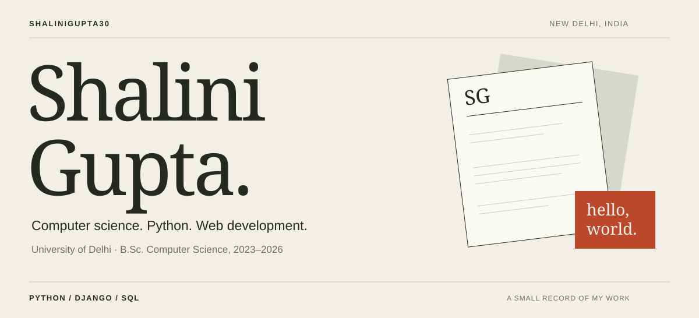

[Email](mailto:guptashalini.554433@gmail.com) &nbsp; / &nbsp; [LinkedIn](https://www.linkedin.com/in/shalinigupta35/) &nbsp; / &nbsp; [Resume Builder](https://github.com/Shalinigupta30/resume-builder-web-app)

I'm **Shalini Gupta**, a Computer Science undergraduate at the University of Delhi. I work with Python, Django, and SQL, and I'm interested in how machine learning can fit into everyday web applications.

My experience includes building a resume generator, AI industrial training, and reaching the finals of my college's Internal Smart India Hackathon.

## Work

**[Resume Builder →](https://github.com/Shalinigupta30/resume-builder-web-app)**  
A full-stack project with dynamic forms for personal details, education, skills, and experience. I used SQLite for storage and HTML, CSS, and Bootstrap for the responsive interface.

The illustration shows the application workflow, not a screenshot.

## What I work with

**Languages** &nbsp; Python · C++ · C · SQL  
**Web & data** &nbsp; Django · HTML · CSS · Bootstrap · MySQL · SQLite  
**Tools** &nbsp; Git · VS Code · Linux · Windows  
**Foundations** &nbsp; Data structures & algorithms · OOP · DBMS · Operating systems

## AI & machine learning

I completed **Artificial Intelligence Industrial Training at InternVision in 2025**. I'd like to build on that foundation through data preparation, model evaluation, and natural language processing.

One project idea is to extend my resume builder with **resume-to-job-description matching**: show which requirements a resume supports and explain the gaps. It's a future project idea, not an implemented feature.

**Planned learning:** pandas, NumPy, scikit-learn, and text embeddings.

## Outside the editor

- **Hackathon finalist** — Internal Smart India Hackathon 2025, ENIAC Society, Department of Computer Science.
- **Campus Ambassador** — AICTE MSME Initiative.
- **Student volunteer** — 12-Week Computer Literacy Programme, Department of Computer Science.
- **Events & design** — Code Quest volunteer; Graphic Team volunteer, Tech Melange 2024.
- **Volleyball** — 1st place in the Inter-Departmental Tournament, 2025, representing Computer Science.

Education & training

**B.Sc. Computer Science — University of Delhi, 2023–2026**

- Artificial Intelligence Industrial Training — InternVision, 2025
- From Zero to SDE Pro: DSA & System Design — GUVI × HCL
- SQL for Analyst Certification
- Splunk Ignite Program
- Network Ninja Bootcamp

---

**Get in touch**  
[guptashalini.554433@gmail.com](mailto:guptashalini.554433@gmail.com) · [LinkedIn](https://www.linkedin.com/in/shalinigupta35/)
