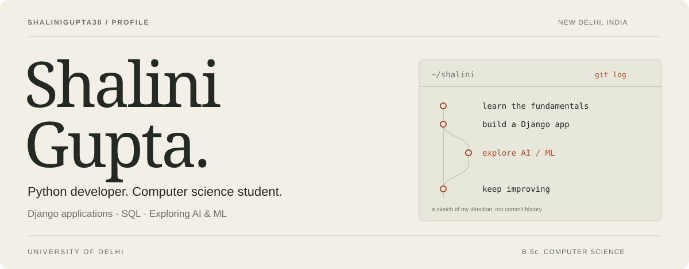
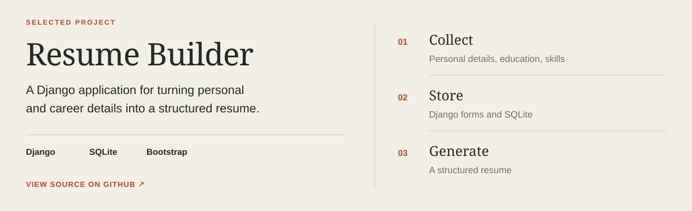

<picture>
  <source media="(prefers-color-scheme: dark)" srcset="header-dark.svg" />
  
</picture>

  <a href="mailto:guptashalini.554433@gmail.com"><b>Email ↗</b></a> &nbsp; · &nbsp;
  <a href="https://www.linkedin.com/in/shalinigupta35/"><b>LinkedIn ↗</b></a> &nbsp; · &nbsp;
  <a href="https://github.com/Shalinigupta30?tab=repositories"><b>Repositories ↗</b></a>

I'm **Shalini Gupta**, a Computer Science undergraduate at the **University of Delhi**. I build with Python, Django, and SQL, and I'm exploring how machine learning can fit into useful web applications.

**Internal SIH ’25 finalist** &nbsp; · &nbsp; **AICTE MSME Campus Ambassador**

 

## A project I built

<a href="https://github.com/Shalinigupta30/resume-builder-web-app">
  <picture>
    <source media="(prefers-color-scheme: dark)" srcset="project-dark.svg" />
    
  </picture>
</a>

**[Browse the code ↗](https://github.com/Shalinigupta30/resume-builder-web-app)** · [Commit history](https://github.com/Shalinigupta30/resume-builder-web-app/commits)

A full-stack application with dynamic forms, SQLite storage, and a responsive Bootstrap interface. It organizes personal details, education, skills, and experience into a structured resume.

Project concept illustration.

## My toolkit

   &nbsp;
   &nbsp;
   &nbsp;
   &nbsp;
   &nbsp;
   &nbsp;
   &nbsp;
   &nbsp;
   &nbsp;
   &nbsp;

**Programming:** Python, C++, C, SQL  
**Web & databases:** Django, HTML, CSS, Bootstrap, MySQL, SQLite  
**Tools:** Git, VS Code, Linux, Windows  
**Foundations:** Data structures & algorithms, OOP, DBMS, operating systems

## A little GitHub activity

<a href="https://github.com/Shalinigupta30?tab=overview">
  <picture>
    <source media="(prefers-color-scheme: dark)" srcset="https://github-readme-stats.vercel.app/api?username=Shalinigupta30&amp;show_icons=true&amp;hide_rank=true&amp;title_color=C4A9E8&amp;text_color=C9D1D9&amp;icon_color=C4A9E8&amp;bg_color=201C2A&amp;hide_border=true&amp;custom_title=Shalini%27s%20GitHub&amp;card_width=480&amp;disable_animations=true" />
    
  </picture>
</a>

[All repositories](https://github.com/Shalinigupta30?tab=repositories) · [Contribution history](https://github.com/Shalinigupta30?tab=overview) · [This profile's source](https://github.com/Shalinigupta30/Shalinigupta30)

Live GitHub data; updates may be cached.

## What I want to explore next

I completed **AI Industrial Training at InternVision in 2025**. My next learning goals are data preparation, model evaluation, and NLP using NumPy, pandas, and scikit-learn.

**An idea on my list:** resume-to-job matching that explains which requirements a resume supports. This is a proposed extension to my Django project.

<b>Beyond code — competitions, leadership & volunteering</b>

- **Finalist:** Internal Smart India Hackathon 2025, ENIAC Society, Department of Computer Science.
- **Campus Ambassador:** AICTE MSME Initiative.
- **Student volunteer:** 12-Week Computer Literacy Programme, Department of Computer Science.
- **Events & design:** Code Quest volunteer; Graphic Team volunteer, Tech Melange 2024.
- **Volleyball:** 1st place, Inter-Departmental Tournament 2025, representing Computer Science.

<b>Education & training</b>

**B.Sc. Computer Science — University of Delhi, 2023–2026**

- Artificial Intelligence Industrial Training — InternVision, 2025
- From Zero to SDE Pro: DSA & System Design — GUVI × HCL
- SQL for Analyst Certification
- Splunk Ignite Program
- Network Ninja Bootcamp

---

### Let’s talk.  
[guptashalini.554433@gmail.com](mailto:guptashalini.554433@gmail.com) · [Connect on LinkedIn](https://www.linkedin.com/in/shalinigupta35/)

Icons by <a href="https://github.com/devicons/devicon">Devicon</a> · Statistics by <a href="https://github.com/anuraghazra/github-readme-stats">GitHub Readme Stats</a>
