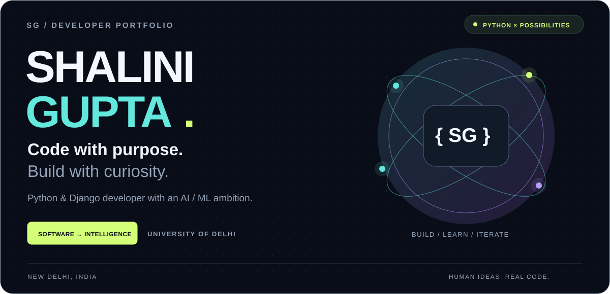
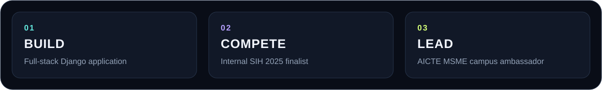
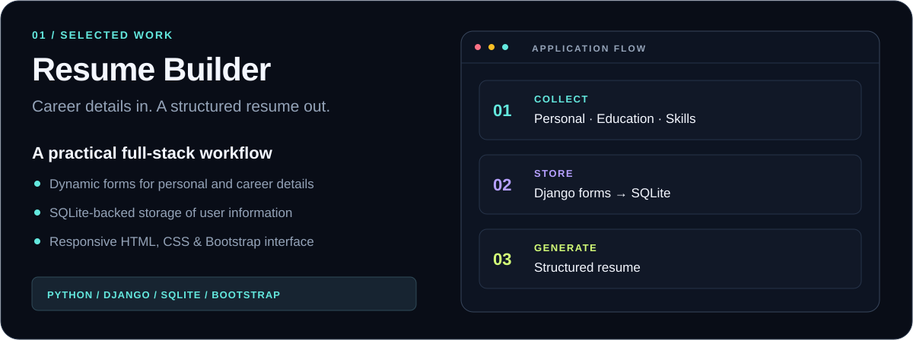
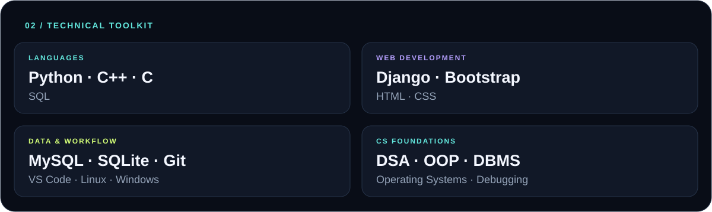
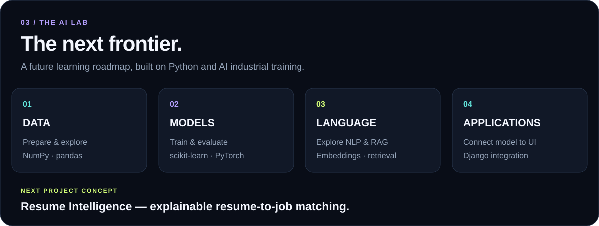
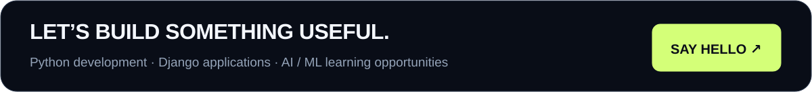

<!-- Upload all six SVG files alongside this README.md at the repository root. -->

  

  
  
  

  <a href="#about">About</a> &nbsp; / &nbsp;
  <a href="#selected-work">Selected work</a> &nbsp; / &nbsp;
  <a href="#toolkit">Toolkit</a> &nbsp; / &nbsp;
  <a href="#ai-lab">AI lab</a> &nbsp; / &nbsp;
  <a href="#beyond-code">Beyond code</a>

### A little context behind the code.

I'm **Shalini Gupta**, a Computer Science undergraduate at the **University of Delhi**. My foundation spans **Python, C++, web development, databases, and core computer science**.

I built a Django resume builder and completed **Artificial Intelligence Industrial Training at InternVision (2025)**. My next direction is to bring those interests together: useful web applications with thoughtfully designed intelligent features.

> **My ambition: make complicated tasks feel simple through software.**

## Selected work

**[Explore the repository ↗](https://github.com/Shalinigupta30/resume-builder-web-app)**

A full-stack application that collects personal information, education, skills, and experience, then organizes those details into structured resumes.

<strong>Inside the build — implementation details</strong>

- **Django:** application logic and dynamic forms for collecting resume details.
- **SQLite:** persistent storage of user information.
- **HTML, CSS & Bootstrap:** a responsive, user-friendly interface.
- **Resume output:** structured presentation of the information users provide.

*The graphic above illustrates the workflow; it is not an application screenshot.*

## My toolkit

<strong>View the full skills list</strong>

| Area | Skills |
| :--- | :--- |
| Languages | Python, C++, C, SQL |
| Web | Django, HTML, CSS, Bootstrap |
| Data | MySQL, SQLite, DBMS fundamentals |
| Foundations | Data Structures & Algorithms, OOP, Operating Systems |
| Workflow | Git, VS Code, Linux, Windows, debugging, version control |

## The AI lab

**Completed training:** Artificial Intelligence Industrial Training — **InternVision, 2025**.

The tools and topics above are **future learning goals**, not claims of completed ML projects or professional expertise. I'm interested in exploring data preparation, model evaluation, natural language processing, and retrieval-augmented generation.

<strong>Explore the concept — Resume Intelligence</strong>

An AI extension to the resume builder could compare a resume with a job description and explain which requirements the person's experience supports.

1. Extract and prepare the text.
2. Compare a keyword baseline with semantic matching.
3. Show evidence and gaps, with understandable explanations.
4. Evaluate false matches and limitations.
5. Bring suggestions into the Django interface for the user to review.

**Design principle:** describe real experience clearly, preserve user control, and never invent qualifications or promise hiring outcomes.

*Project concept — not yet a completed feature.*

## Beyond the code

| | Experience |
| :--- | :--- |
| **🏆 Compete** | Finalist, **Internal Smart India Hackathon 2025**, ENIAC Society, Department of Computer Science |
| **🚀 Lead** | **Campus Ambassador**, AICTE MSME Initiative |
| **🤝 Contribute** | Student volunteer, **12-Week Computer Literacy Programme**, Department of Computer Science |
| **🎨 Create** | Code Quest volunteer · Graphic Team volunteer, **Tech Melange 2024** |
| **🏐 Team up** | **1st place**, Inter-Departmental Volleyball Tournament 2025, representing Computer Science |

### Education & continuous learning

**B.Sc. Computer Science · University of Delhi · 2023–2026**

<strong>Certifications & training</strong>

- Artificial Intelligence Industrial Training — **InternVision, 2025**
- From Zero to SDE Pro: DSA & System Design — **GUVI × HCL**
- SQL for Analyst Certification
- Splunk Ignite Program
- Network Ninja Bootcamp

 

  <a href="mailto:guptashalini.554433@gmail.com">Email</a> &nbsp; · &nbsp;
  <a href="https://www.linkedin.com/in/shalinigupta35/">LinkedIn</a> &nbsp; · &nbsp;
  <a href="https://github.com/Shalinigupta30/resume-builder-web-app">Featured project</a>

Curiosity starts the work. Building makes it real.

